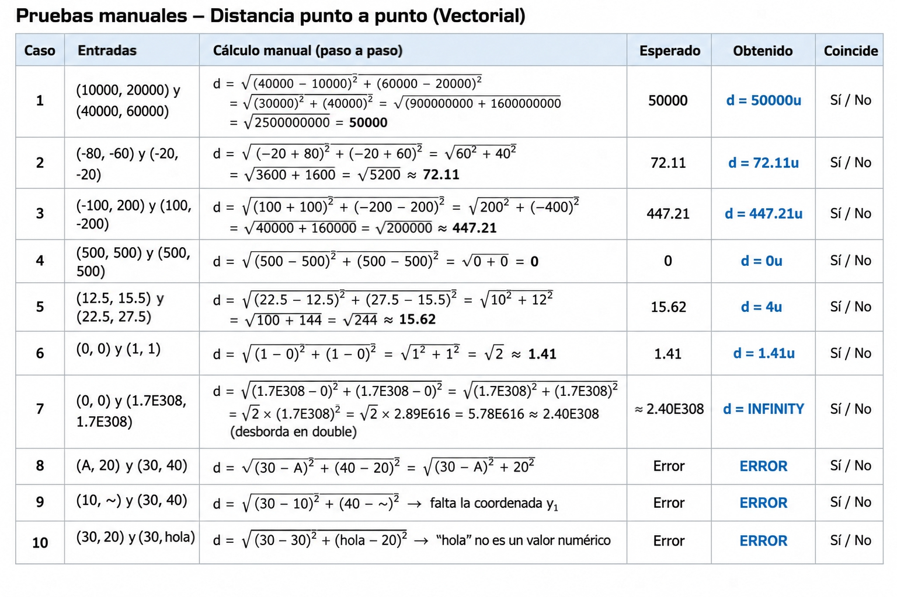

# Pruebas manuales - 2
## Modulo Geometrico-Vectorial
El problema consiste en desarrollar un programa que permita calcular la distancia entre dos puntos en un plano cartesiano, a partir de sus coordenadas:

P1 (x1, y1): Representa el punto inicial.
P2 (x2, y2): Representa el punto final.
A partir de estas coordenadas, el programa obtiene los incrementos en los ejes X y Y, y calcula la magnitud del desplazamiento entre ambos puntos mediante el teorema de Pitágoras.
## Entradas, tipos de datos, valores válidos y salidas
### Entradas
El programa solicita las coordenadas de dos puntos en un plano cartesiano. Cada punto está formado por una coordenada X y una coordenada Y.

| Variable | Tipo de dato | Descripción | Valores válidos |
|---|---|---|---|
| x1 | double | Coordenada X del primer punto | Números positivos, negativos y decimales |
| y1 | double | Coordenada Y del primer punto | Números positivos, negativos y decimales |
| x2 | double | Coordenada X del segundo punto | Números positivos, negativos y decimales |
| y2 | double | Coordenada Y del segundo punto | Números positivos, negativos y decimales |

Las coordenadas deben ser valores numéricos válidos y finitos. También se permite introducir el valor cero.
### Salidas
El programa muestra la distancia entre los dos puntos, expresada en unidades (u), utilizando la fórmula de distancia euclidiana.
Si se introducen datos no numéricos, incompletos o inválidos, el programa debe identificar el error correspondiente.
 